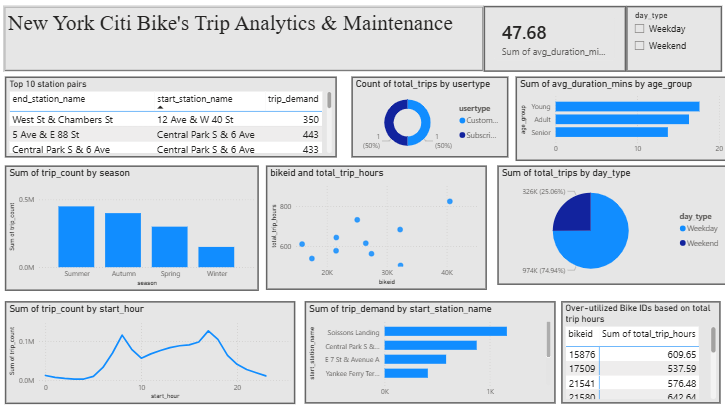

# Citi Bike Analytics — Spark, Spark SQL & SparkML

End-to-end big data pipeline over historical New York Citi Bike trip data, built for a
city-planning use case: cleaning and anomaly flagging, geospatial feature engineering,
ten analytical Spark SQL queries, a SparkML classifier comparison, and a Power BI dashboard.

**Stack:** PySpark · Spark SQL · SparkML · Power BI

---

## Team

This was a **six-person university group project** for a Big Data & NoSQL Databases course.

Habiba Farouk · Ahmed Sherif · Jamila Riad · Morin Hanna · Pierre Ashraf · Andrew Nabil

> **My contribution (Pierre Ashraf):** data cleaning, anomaly flagging and feature
> engineering (section 1), jointly with Ahmed Sherif. The analytical queries, SparkML task
> and dashboard were built by the teammates listed above.

## Pipeline

**Cleaning and anomaly flagging.** Nulls dropped on an explicit subset of analysis-critical
columns rather than blanket `dropna()`, empty strings and sentinel zeros filtered from ID and
birth-year fields, `gender` codes mapped to labels, and four anomaly flags applied: short
trips (< 60s), implausible speed (> 40 km/h), age outliers (< 12 or > 100), and missing
essential identifiers.

**Feature engineering.** Rider age at time of trip, age group, trip duration, Haversine
distance between station coordinates, derived speed, period of day, start month, season, and
a weekend indicator — each inserted as a stored column on the dataset and validated after
creation, not computed inline at query time.

Timestamp columns are cast explicitly with `to_timestamp` rather than left to `inferSchema`.
Citi Bike timestamps carry fractional seconds, which can make Spark type them as strings; a
string there propagates silently as NULL through every time-derived feature downstream.

**Ten Spark SQL queries**, including window functions (`RANK()` over station popularity, a
partitioned CTE ranking end stations within each user type), UDF-driven categorisation for
age bands and seasons, and station-pair demand ranked both by total volume and by average
rides per active day.

**SparkML**: Logistic Regression, Decision Tree and Random Forest compared on a shared
feature pipeline (`StringIndexer` → `OneHotEncoder` → `StandardScaler` → `VectorAssembler`).

## Dashboard



Built in Power BI by teammates as the project's bonus component, covering hourly demand,
seasonal volume, weekday versus weekend split, top station pairs, and a bike-utilisation
table for maintenance scheduling, with day-type filtering. Shown here as a screenshot; the
`.pbix` source is not redistributed in this repo.

Two tiles are built on exported query results rather than trip-level data and are unreliable
as drawn: the user-type donut shows a 50/50 split because it counts the two *rows* of the
exported CSV rather than the trips behind them (the real split is 86% subscriber / 14%
customer), and the duration KPI sums averages across groups, which is not a meaningful
quantity. Both are noted here rather than quietly left in place; fixing them is listed below.

## Findings

The extract used here is **1.3M trips from 2019**, reduced to 1,299,312 after cleaning (655
records removed by the four noise flags).

**Demand is a textbook commuter pattern.** Trip starts peak twice: 17:00 (126,578 trips) and
08:00 (115,714), with a trough through the middle of the day. Weekdays carry 74.9% of volume
against 25.1% at weekends.

**Weekend trips are different in kind, not just in number.** They run 30% longer (19.4 vs
14.9 minutes) and 12% slower (7.9 vs 9.1 km/h) at near-identical distance (1.81 vs 1.76 km).
Same journeys, taken less urgently — leisure riding rather than commuting.

**Casual riders take round trips 3.3× as often as subscribers** (5.3% vs 1.6%), consistent
with recreational loops against point-to-point commutes.

**Subscriber and casual destinations barely overlap.** Subscribers end at transit and
business hubs — Pershing Square N (9,263 trips), Broadway & E 22 St, 8 Ave & W 31 St. Casual
riders end at Central Park and the waterfront — 5 Ave & E 88 St (2,363), Central Park S &
6 Ave, 5 Ave & E 73 St. Two populations using one network for different purposes, which is
the clearest argument in the analysis for segmenting rebalancing by location rather than
treating the network uniformly.

**Ranking station pairs by intensity rather than volume surfaces a different network.** The
top pairs by average rides per active day are all on Governors Island — Soissons Landing,
Yankee Ferry Terminal, Picnic Point — at 20–26 rides per active day across only 13–17 active
days. By raw totals they never appear. The island is seasonal and ferry-fed, so it generates
very high demand on the days it operates and none otherwise. That is an operationally
distinct problem from a year-round corridor like E 7 St & Avenue A → Cooper Square (585 trips
over 39 days), and ranking on totals alone hides it entirely.

**Utilisation is concentrated on a small number of bikes**, supporting usage-based rather
than calendar-based maintenance scheduling.

## Two results that are not what they appear

**The seasonal trip counts are a sampling artefact.** Monthly row counts come out at 50,000
(Jan), 49,997 (Feb), 99,994 (Mar), 100,000 (Apr), 100,000 (May), 150,000 (Jun) and so on.
Those are quotas, not measurements — real ridership does not land on round hundred-thousands.
This extract was built by sampling a fixed number of trips per month, so "summer is three
times winter" is the sampling design reflected back, not a finding.

Real Citi Bike data does show seasonality in the same direction, so the conclusion happens to
point the right way — but it cannot be supported by this table. What survives are the
within-season averages, which don't depend on how many rows each month contributes: winter
trips average 13.9 minutes against 17.0 in summer, a genuine behavioural difference.

**The gender classifier does not beat a constant prediction.** The target is 73.9% male among
riders who reported it, so always answering "Male" scores 0.7395. Against that:

| Model | Accuracy | F1 | vs baseline |
|---|---|---|---|
| Random Forest | 0.7393 | 0.628 | −0.0002 |
| Logistic Regression | 0.7389 | 0.630 | −0.0006 |
| Decision Tree | 0.7311 | 0.643 | −0.0084 |
| **Baseline (always "Male")** | **0.7395** | — | — |

All three land *below* the baseline. A linear model, a single tree and a 50-tree ensemble
converging within a point of each other and of a constant prediction means the limit is the
information in the features, not the algorithm: trip duration, distance, speed, month, user
type and period of day carry essentially no signal about a rider's self-reported gender.

The feature-importance output says the same thing from another angle. The dominant feature in
both the logistic regression (coefficient −0.35) and the decision tree (importance 0.36) is
*period of day* — the models are picking up when people ride, and finding that it doesn't
separate the classes. Reporting the top scorer as "best" here would describe the class
distribution rather than a working classifier.

## Notes on method

**Speed is systematically underestimated.** `trip_distance_km` is the straight-line Haversine
distance between stations, always shorter than the route actually cycled and *zero* for round
trips returning to the same dock. The over-speed rule flagged exactly one trip in 1.3M
(52.97 km/h), and that low count is a property of the metric rather than evidence the data is
clean. Duration-based rules or routed network distance would be more reliable.

**Age is computed against the trip year.** Deriving it from the current year instead would add
a year of error for every year since collection, silently corrupting the age column, the
outlier flag, the age-band query and the ML feature set.

**Timestamps are cast explicitly.** Citi Bike timestamps carry fractional seconds, which can
make `inferSchema` type them as strings; a string there propagates as NULL through every
time-derived feature downstream. The cast is validated immediately after.

## What I'd do next

- Replace the Python UDFs with native Spark expressions throughout; UDFs serialise every row
  out of the JVM and dominate runtime at this volume.
- Persist the cleaned dataset as partitioned Parquet instead of recomputing the full cleaning
  chain for each query.
- Rebuild two dashboard tiles that aggregate exported query results rather than trip-level
  data, which makes the user-type split and the duration KPI unreliable.
- Add station-level and weather features before revisiting any predictive task.

## Running it

```bash
pip install -r requirements.txt
jupyter notebook notebooks/citibike_spark_analysis.ipynb
```

The dataset downloads at runtime via `gdown`. No data is committed to this repo.

## Repo structure

```
.
├── notebooks/
│   └── citibike_spark_analysis.ipynb
├── dashboard/
│   └── dashboard.png
├── requirements.txt
├── .gitignore
└── README.md
```

---

**Pierre Ashraf** — B.Sc. Business Informatics, German International University
[LinkedIn](https://linkedin.com/in/pierreaziz21)
